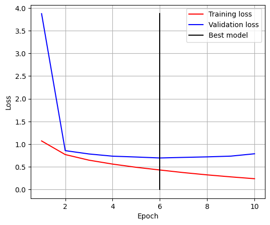
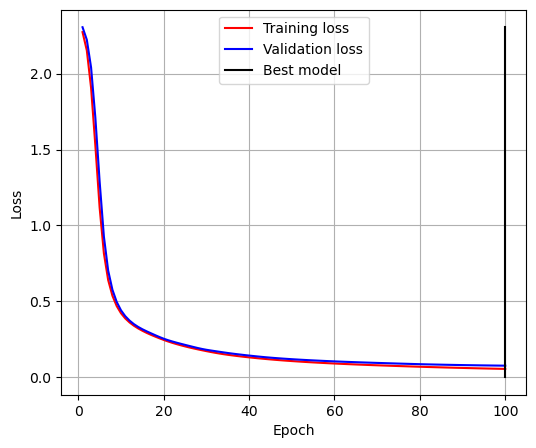

# CNNs and Transfer Learning in PyTorch

Training convolutional networks from scratch on CIFAR-10, then reusing pretrained networks through fine-tuning, feature extraction and cross-domain transfer.

> Lab 0 of *Advanced Deep Learning (D7047E)*, Luleå University of Technology, spring 2024. Group 7; see [Team](#team).

## Results

| Experiment | Setup | Test accuracy |
|---|---|---|
| CNN from scratch, CIFAR-10 | LeakyReLU + SGD | 11.6% |
| | LeakyReLU + **Adam** | **53.9%** |
| | Tanh + SGD | 9.6% |
| | Tanh + Adam | 44.1% |
| Transfer from ImageNet, CIFAR-10 | AlexNet, **fine-tuning** all layers | **76.0%** |
| | AlexNet, feature extraction (frozen backbone) | 56.7% |
| Transfer between digit datasets | CNN trained on MNIST, tested on MNIST | 98.0% |
| | Same MNIST model applied to SVHN | 15.4% |

<p>


</p>

## What the experiments show

- **The optimiser mattered more than the activation.** With plain SGD the network barely moved from chance (10% on 10 classes). Adam got the same architecture to 54%.
- **LeakyReLU beat Tanh** by about 10 points with Adam, as expected from its non-saturating gradient.
- **Pretraining is worth a lot.** Fine-tuning an ImageNet AlexNet beat the best from-scratch CNN by 22 points.
- **Fine-tuning beats feature extraction** here, because CIFAR-10's tiny 32×32 images differ enough from ImageNet that the deeper layers need to adapt.
- **Domain shift is brutal.** A digit model with 98% accuracy on clean MNIST drops to 15% on real-world house-number photos (SVHN), showing why transfer only works between related domains.

## Running the code (VS Code / Python)

The experiments are a Python package with a command-line entry point. All datasets (CIFAR-10, MNIST, SVHN) download automatically through `torchvision` into `data/raw/`; loss curves and sample images are saved to `outputs/`.

```bash
python -m venv .venv
source .venv/bin/activate        # Windows: .venv\Scripts\activate
pip install -r requirements.txt

python main.py cifar-cnn --activation leakyrelu   # 0.1, SGD vs Adam
python main.py cifar-cnn --activation tanh
python main.py transfer-imagenet                  # 0.2.1, AlexNet fine-tuning vs feature extraction
python main.py transfer-mnist-svhn                # 0.2.2, MNIST model applied to SVHN
python main.py all                                # everything
python main.py cifar-cnn --help                   # epochs, learning rate, batch size, ...
```

In VS Code, open the folder, pick the `.venv` interpreter, and use the **Run and Debug** panel: `.vscode/launch.json` has a launch configuration for each experiment. `pytest` runs fast smoke tests on random data (no downloads).

| Path | Contents |
|---|---|
| [`main.py`](main.py) | Command-line entry point |
| [`cnn_transfer/data.py`](cnn_transfer/data.py) | CIFAR-10, MNIST and SVHN loaders with an 80/20 train/validation split |
| [`cnn_transfer/models.py`](cnn_transfer/models.py) | Small CNN (LeakyReLU/Tanh/ReLU) and pretrained AlexNet with a new head |
| [`cnn_transfer/training.py`](cnn_transfer/training.py) | Training loop keeping the best-validation model, accuracy, loss plots |
| [`cnn_transfer/experiments.py`](cnn_transfer/experiments.py) | The three experiments, with the notebooks' hyperparameters as defaults |

## Original notebooks

The original notebooks, with their saved outputs, are kept in [`notebooks/`](notebooks/):

| Notebook | Contents |
|---|---|
| [`0.1_cifar10_cnn_leakyrelu.ipynb`](notebooks/0.1_cifar10_cnn_leakyrelu.ipynb) | CNN on CIFAR-10 with LeakyReLU, SGD vs Adam |
| [`0.1_cifar10_cnn_tanh.ipynb`](notebooks/0.1_cifar10_cnn_tanh.ipynb) | Same network with Tanh |
| [`0.2_transfer_learning.ipynb`](notebooks/0.2_transfer_learning.ipynb) | AlexNet fine-tuning and feature extraction; MNIST → SVHN transfer |

## Team

Group 7, D7047E Advanced Deep Learning: **Aamer Barood** and teammates. The original group repository, with full commit history, is [Gabmyr/D7047E-Labs-Group-7](https://github.com/Gabmyr/D7047E-Labs-Group-7).
